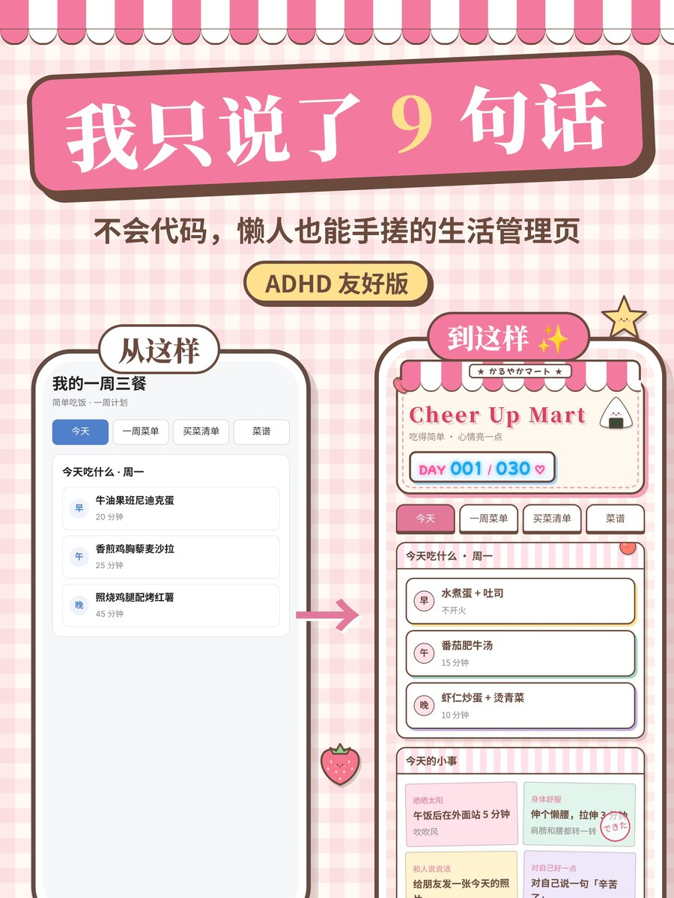

<p align="center">
  
</p>

<h1 align="center">Cheer Up Mart</h1>

<p align="center">
  日系便利店风的生活管理小网页 · 懒人友好 · ADHD 友好<br>
  👉 <a href="https://redpanda0614.github.io/cheer-up-mart/"><b>直接打开试试</b></a>
</p>

<p align="center">
  
</p>

## 它能做什么

- 🍙 **今天吃什么**：一周三餐排好了，每顿 15 分钟左右能做完。
- 🧺 **买菜清单**：周末买一次就够一周，买到的打个勾。
- 📖 **菜谱小本子**：一页一道菜，像翻书一样往后翻。
- ✿ **今天的小事**：每天随机抽几件小事，做完点一下盖个章。
- ✏️ **体重和心情**：想记就记，不想记也没关系。
- 🏪 **DAY 霓虹招牌**：显示今天是计划的第几天。

只有一个 `index.html`，打开就能用。不用注册，不用下载 App。

## 截图

<table>
  <tr>
    <td></td>
    <td></td>
  </tr>
  <tr>
    <td></td>
    <td></td>
  </tr>
  <tr>
    <td></td>
    <td></td>
  </tr>
  <tr>
    <td colspan="2" align="center"></td>
  </tr>
</table>

## 怎么用

- 点右上角的「✎ 自定义」，可以改标题、计划天数、菜谱、一周菜单、买菜清单和小事清单。
- 每个人的数据都只存在自己的浏览器里，别人看不到。
- 想要一份完全属于自己的版本，可以照下面的步骤放到你自己的 GitHub Pages 上，或者交给 AI 帮你改。

## 用 GitHub Pages 免费上线（大约 5 分钟）

1. 登录 GitHub，点右上角 **+** → **New repository**。
   - 名字随便起，比如 `happy-plan`。
   - 选 **Public**，点 **Create repository**。
2. 在新仓库页面点 **uploading an existing file**，把 `index.html` 和 `apple-touch-icon.png` 一起拖进去（这个 README 也可以一起传），点 **Commit changes**。
   - `apple-touch-icon.png` 就是主屏幕上的饭团图标，要和 `index.html` 放在同一层。
3. 进入仓库的 **Settings** → 左边的 **Pages**。
   - **Source** 选 **Deploy from a branch**。
   - **Branch** 选 `main`，文件夹选 `/ (root)`，点 **Save**。
4. 等 1 到 2 分钟，刷新这个页面，上面会出现网址：
   `https://你的用户名.github.io/happy-plan/`
5. 把这个网址发给别人就行。

以后想改内容，在仓库里点 `index.html` → 铅笔图标编辑，或者重新上传覆盖。保存后 1 到 2 分钟网站会自动更新。

## 在手机上用

- **iPhone**：用 Safari 打开网址 → 分享按钮 → 「添加到主屏幕」。图标是一个饭团，名字是 Cheer Up Mart。
- **安卓**：用 Chrome 打开 → 右上角菜单 → 「添加到主屏幕」。

## 让你的 AI 搭子帮你改

整个网站就是一个 `index.html` 文件，很适合交给 AI 改。豆包、Kimi、DeepSeek、ChatGPT、Claude 都可以。

1. 在这个仓库里点 `index.html` → 右上角的下载按钮，把文件存下来。
2. 把文件发给你的 AI，再把下面这段话复制给它，改成你自己的情况：

```
这是一个叫 Cheer Up Mart 的生活管理小网页，只有一个 HTML 文件。
请帮我改成适合我的版本，保持现在的日系便利店风格和所有功能不变。
我的情况：
- 我不吃：（比如 香菜、牛肉）
- 我喜欢吃：（比如 面食、鸡蛋）
- 我每周能花在做饭上的时间：（比如 1 小时）
- 我想加的小事：（比如 遛狗、练字）
- 其他想改的：（比如 换成蓝色、标题改成我的名字）
改完请把完整的 HTML 文件发回给我。
```

3. 拿到新文件后，用电脑浏览器直接打开就能用。想用手机打开，可以照上面的步骤，也放到你自己的 GitHub Pages 上。

小提示：网站里点「✎ 自定义」也能改菜谱、菜单、买菜清单和小事清单，简单的修改不用 AI 也行。

## 关于数据

- 数据存在浏览器里。清除浏览器数据、换手机、换浏览器，记录都会不见。
- 换设备前，在「✎ 自定义」→「备份」里导出备份文件，到新设备上再导入就行。
- 「恢复默认内容」只会把菜谱、菜单和清单改回默认，不会删掉体重和打卡记录。

## 提醒

饮食内容只是一般参考，不是医疗建议。
