<p align="center">
  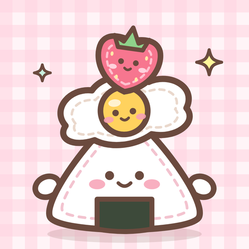
</p>

<h1 align="center">Cheer Up Mart</h1>

<p align="center">
  <b>日系便利店风的生活管理小网页</b><br>
  吃得简单 · 心情亮一点 · 懒人和 ADHD 友好
</p>

<p align="center">
  <a href="https://redpanda0614.github.io/cheer-up-mart/"></a>
</p>

<p align="center">
  
  
  
  
</p>

<p align="center">
  <a href="#-看看长什么样">看看长什么样</a> ·
  <a href="#-马上用起来">马上用起来</a> ·
  <a href="#-做一个自己的版本">做一个自己的版本</a> ·
  <a href="#-关于数据">关于数据</a>
</p>

<p align="center">
  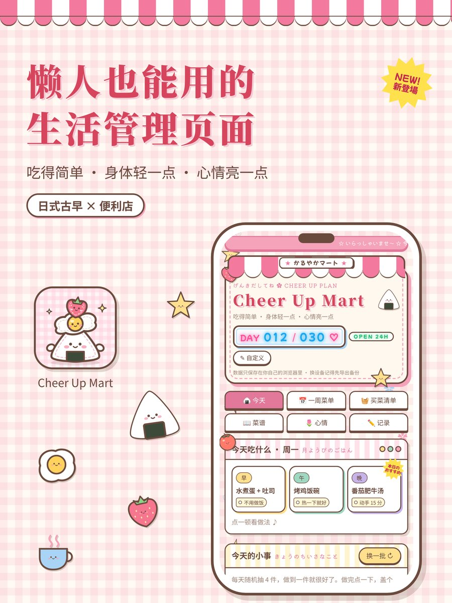
</p>

---

## 🏪 看看长什么样

<table>
  <tr>
    <td width="33%" align="center">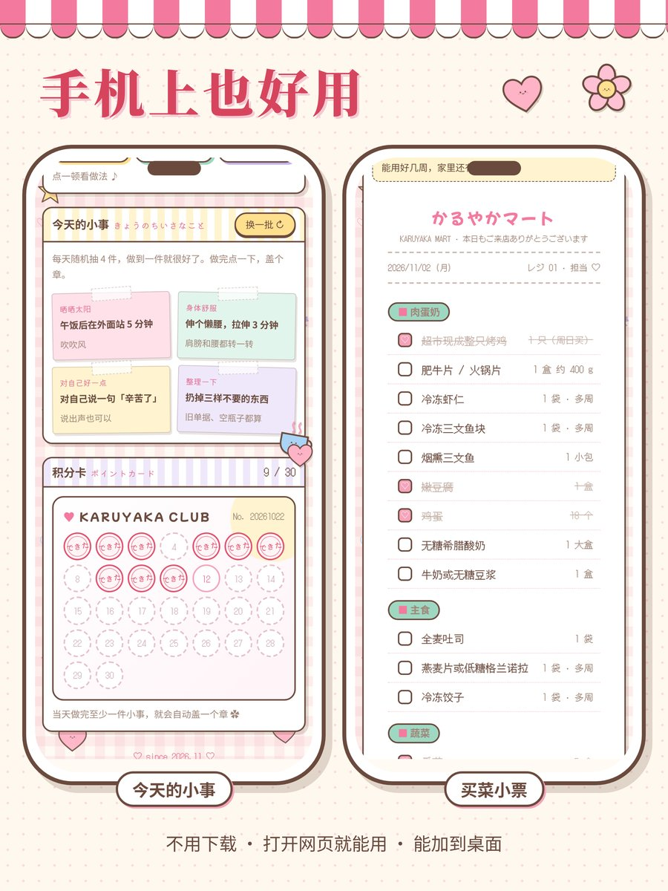<br><b>📱 手机上也好用</b><br><sub>加到桌面，像 App 一样打开</sub></td>
    <td width="33%" align="center">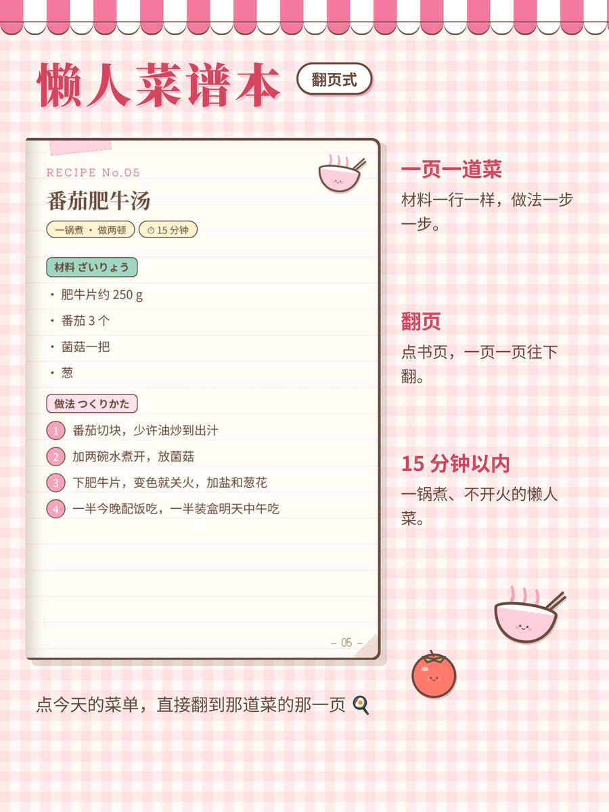<br><b>📖 菜谱小本子</b><br><sub>一页一道菜，点着往后翻</sub></td>
    <td width="33%" align="center">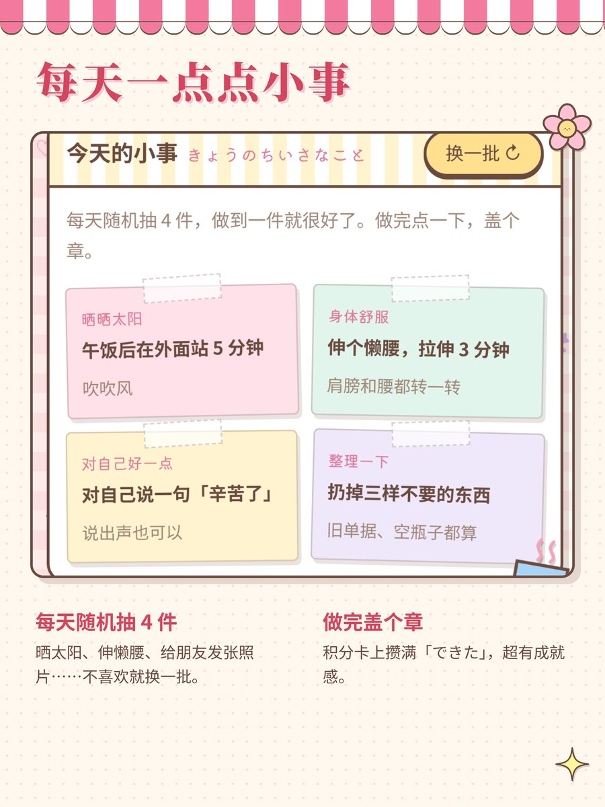<br><b>✿ 今天的小事</b><br><sub>随机抽几件，做完盖个章</sub></td>
  </tr>
  <tr>
    <td width="33%" align="center">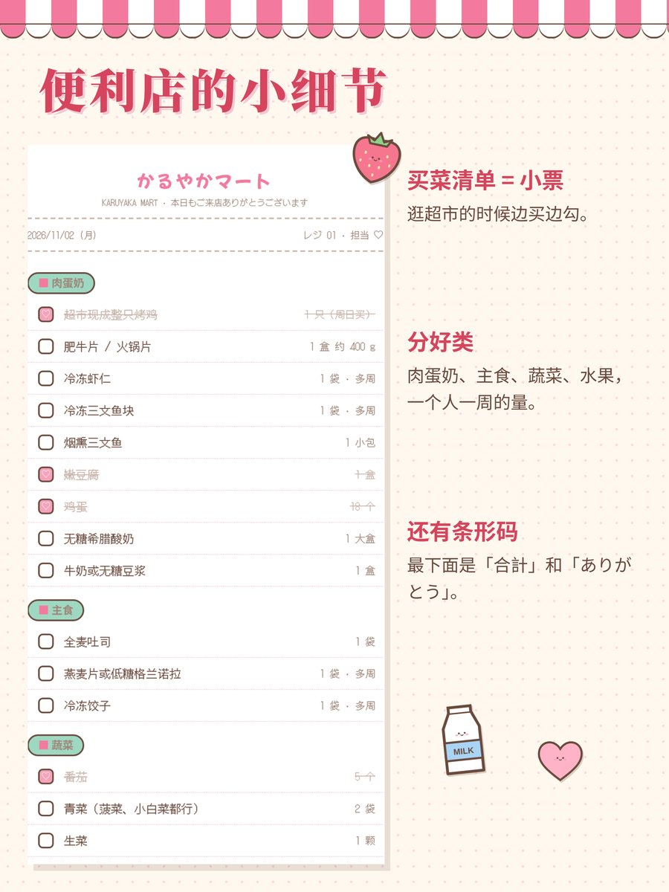<br><b>🏪 便利店小细节</b><br><sub>遮阳棚、DAY 霓虹招牌</sub></td>
    <td width="33%" align="center">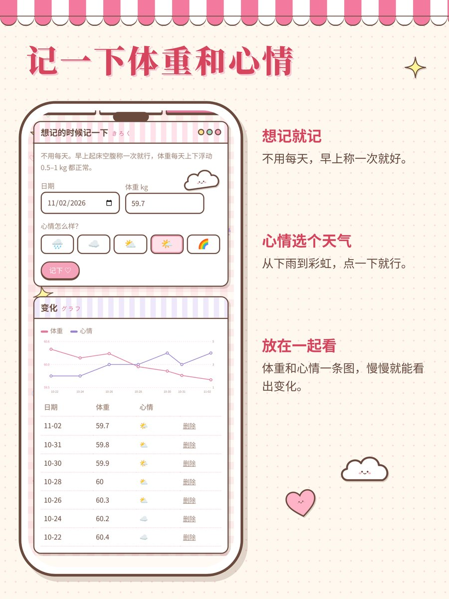<br><b>✏️ 体重和心情</b><br><sub>想记就记，不记也没关系</sub></td>
    <td width="33%" align="center">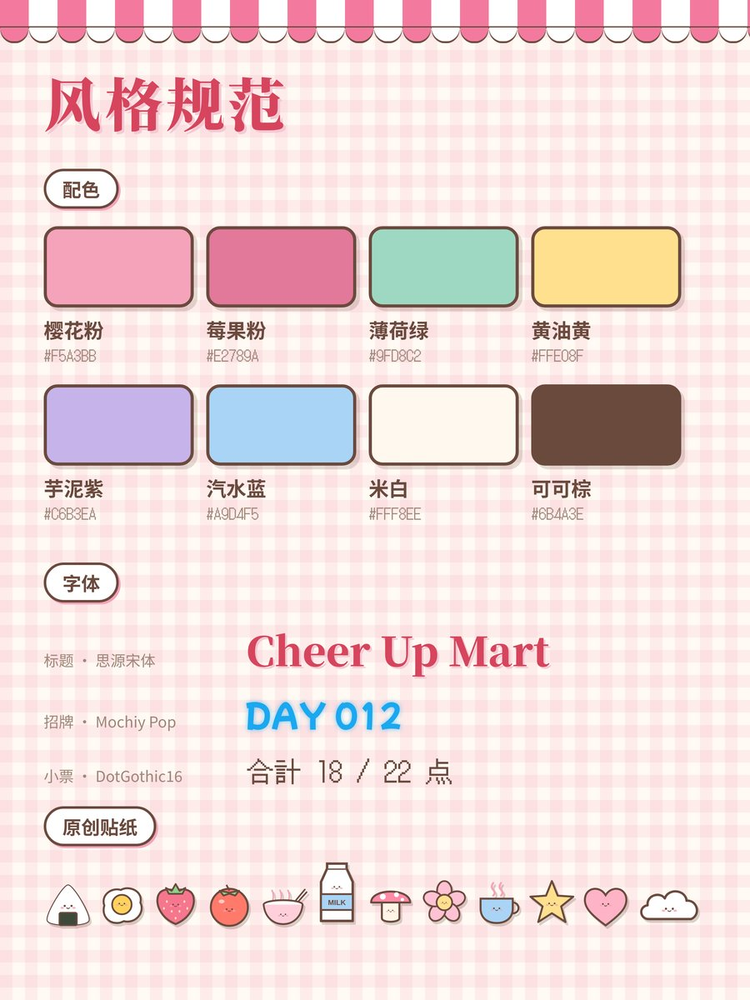<br><b>🎀 风格规范</b><br><sub>配色、字体、小贴纸</sub></td>
  </tr>
</table>

| 🍙 今天吃什么 | 🧺 买菜清单 | 📅 一周菜单 |
| :---: | :---: | :---: |
| 每顿 15 分钟左右能做完 | 周末买一次就够一周 | 三餐都排好了，不用每天想 |

---

## 🚀 马上用起来

**最快的方式：**直接打开 👉 [redpanda0614.github.io/cheer-up-mart](https://redpanda0614.github.io/cheer-up-mart/)

点右上角的「✎ 自定义」，可以改标题、计划天数、菜谱、一周菜单、买菜清单和小事清单。

<details>
<summary><b>📱 怎么加到手机桌面？</b></summary>
<br>

- **iPhone**：用 Safari 打开网址 → 分享按钮 → 「添加到主屏幕」。图标是一个饭团，名字是 Cheer Up Mart。
- **安卓**：用 Chrome 打开 → 右上角菜单 → 「添加到主屏幕」。

</details>

---

## 🎨 做一个自己的版本

<details>
<summary><b>🤖 方法一：交给 AI 搭子帮你改（推荐）</b></summary>
<br>

整个网站就是一个 `index.html` 文件，很适合交给 AI 改。豆包、Kimi、DeepSeek、ChatGPT、Claude 都可以。

1. 在这个仓库里点 `index.html` → 右上角的下载按钮，把文件存下来。
2. 把文件发给你的 AI，再把下面这段话复制给它，改成你自己的情况：

```
这是一个叫 Cheer Up Mart 的生活管理小网页，只有一个 HTML 文件。
请帮我改成适合我的版本，保持现在的日系便利店风格和所有功能不变。
我的情况：
- 我不吃：（比如 香菜、牛肉）
- 我喜欢吃：（比如 面食、鸡蛋）
- 我每周能花在做饭上的时间：（比如 1 小时）
- 我想加的小事：（比如 遛狗、练字）
- 其他想改的：（比如 换成蓝色、标题改成我的名字）
改完请把完整的 HTML 文件发回给我。
```

3. 拿到新文件后，用电脑浏览器直接打开就能用。想用手机打开，可以照上面的步骤，也放到你自己的 GitHub Pages 上。

小提示：网站里点「✎ 自定义」也能改菜谱、菜单、买菜清单和小事清单，简单的修改不用 AI 也行。

</details>

<details>
<summary><b>🌐 方法二：用 GitHub Pages 免费上线（大约 5 分钟）</b></summary>
<br>

1. 登录 GitHub，点右上角 **+** → **New repository**。
   - 名字随便起，比如 `happy-plan`。
   - 选 **Public**，点 **Create repository**。
2. 在新仓库页面点 **uploading an existing file**，把 `index.html` 和 `apple-touch-icon.png` 一起拖进去（这个 README 也可以一起传），点 **Commit changes**。
   - `apple-touch-icon.png` 就是主屏幕上的饭团图标，要和 `index.html` 放在同一层。
3. 进入仓库的 **Settings** → 左边的 **Pages**。
   - **Source** 选 **Deploy from a branch**。
   - **Branch** 选 `main`，文件夹选 `/ (root)`，点 **Save**。
4. 等 1 到 2 分钟，刷新这个页面，上面会出现网址：
   `https://你的用户名.github.io/happy-plan/`
5. 把这个网址发给别人就行。

以后想改内容，在仓库里点 `index.html` → 铅笔图标编辑，或者重新上传覆盖。保存后 1 到 2 分钟网站会自动更新。

</details>

<details>
<summary><b>📚 不会代码？看 8 张图文教程，从零手搓一个</b></summary>
<br>

<table>
  <tr>
    <td align="center">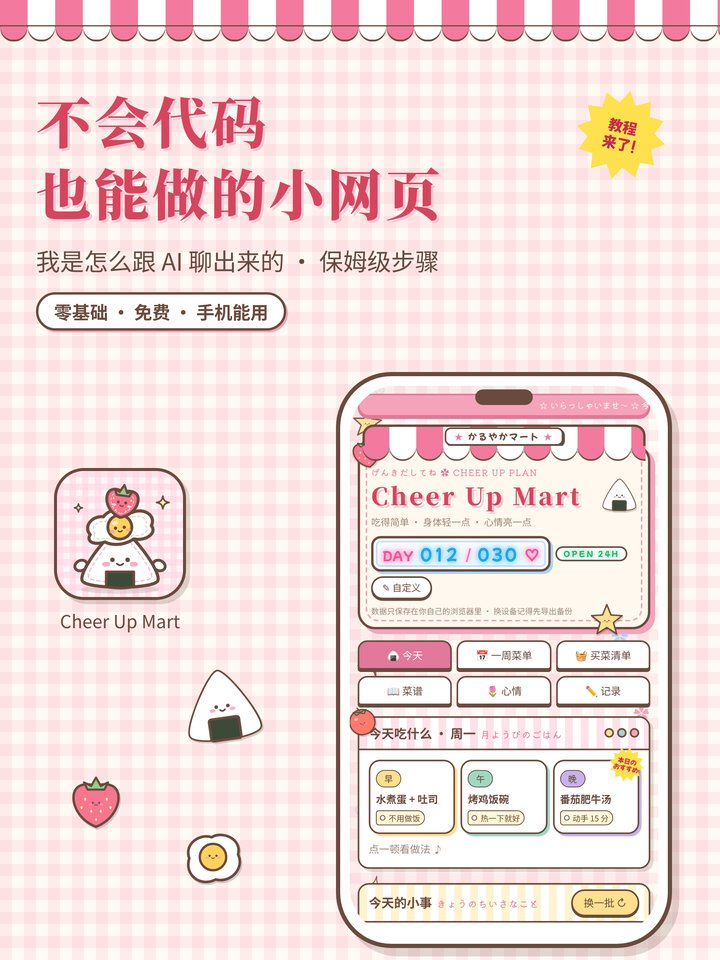</td>
    <td align="center">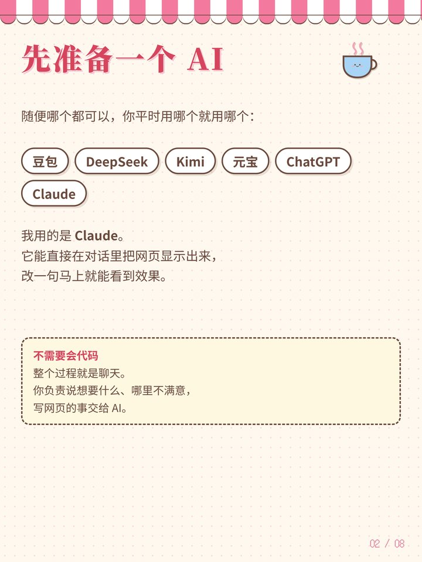</td>
    <td align="center">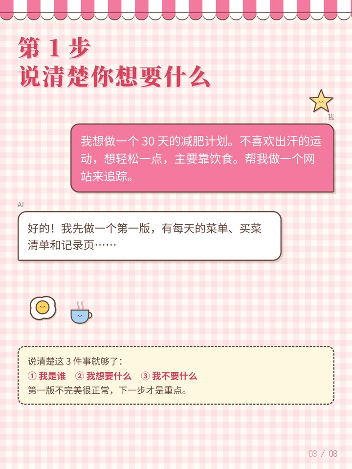</td>
    <td align="center">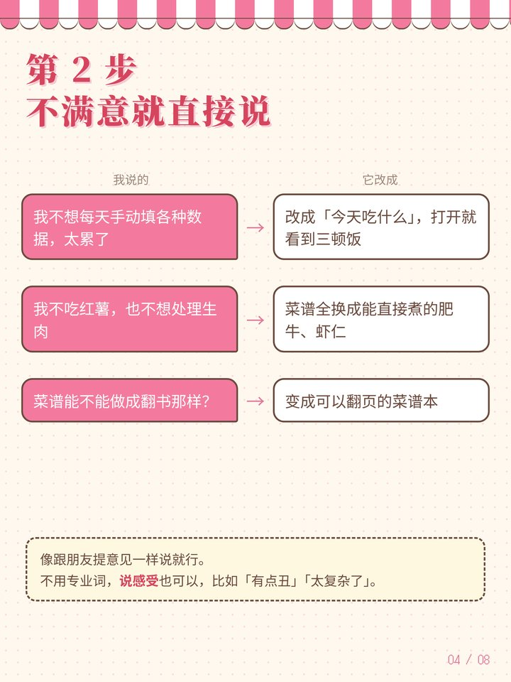</td>
  </tr>
  <tr>
    <td align="center">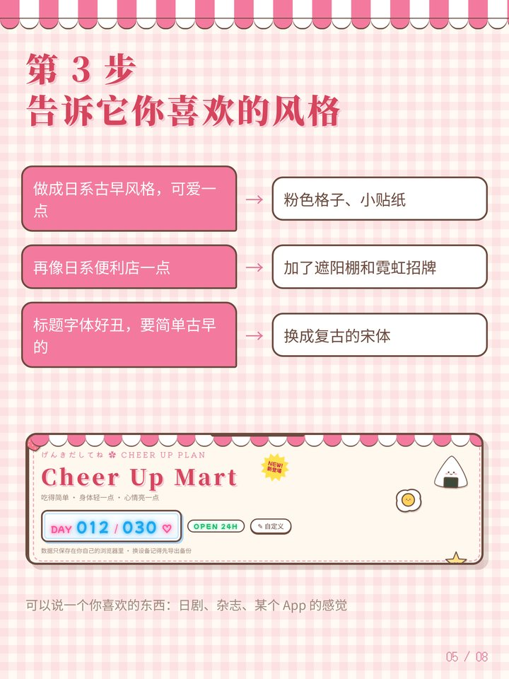</td>
    <td align="center">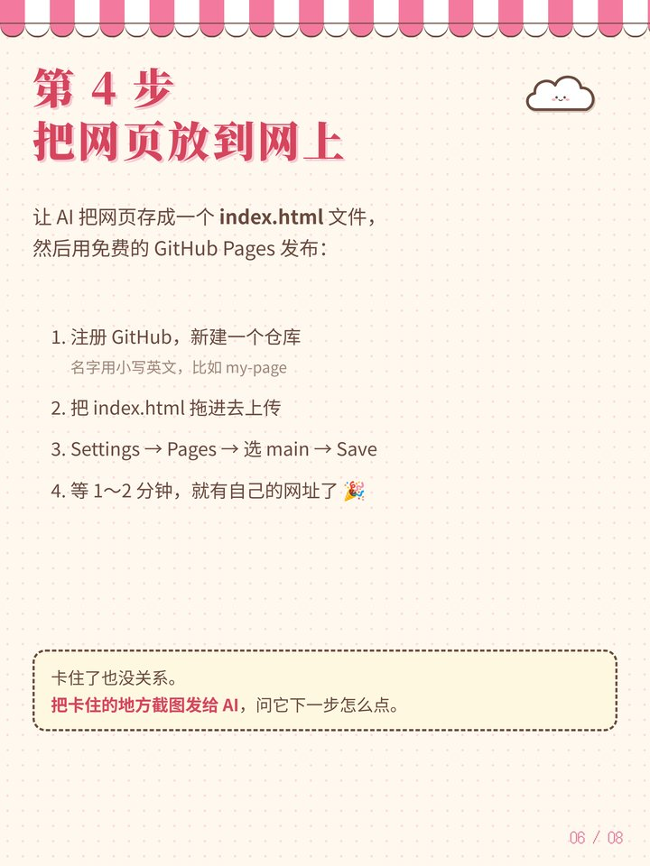</td>
    <td align="center">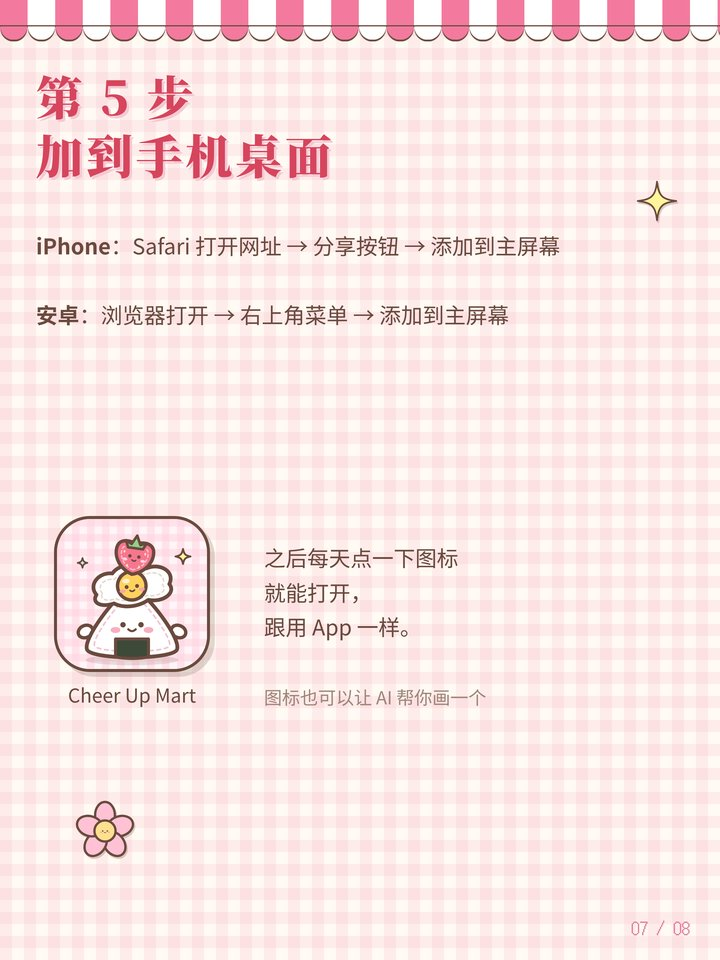</td>
    <td align="center">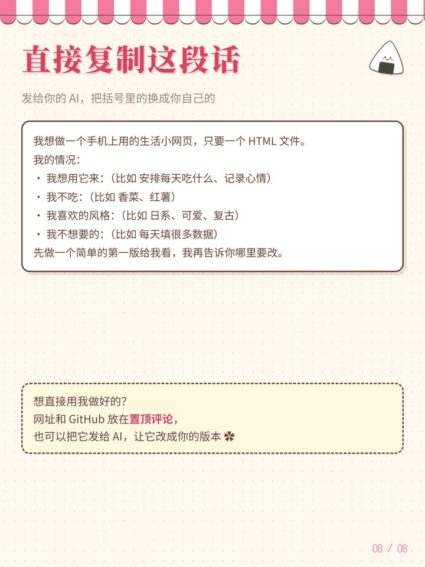</td>
  </tr>
</table>

<sub>点图片可以看大图。</sub>

</details>

---

## 💾 关于数据

- 数据存在浏览器里。清除浏览器数据、换手机、换浏览器，记录都会不见。
- 换设备前，在「✎ 自定义」→「备份」里导出备份文件，到新设备上再导入就行。
- 「恢复默认内容」只会把菜谱、菜单和清单改回默认，不会删掉体重和打卡记录。

---

<p align="center">
  <sub>饮食内容只是一般参考，不是医疗建议。</sub><br>
  <sub>喜欢的话点个 ⭐ Star 吧 ✿</sub>
</p>
